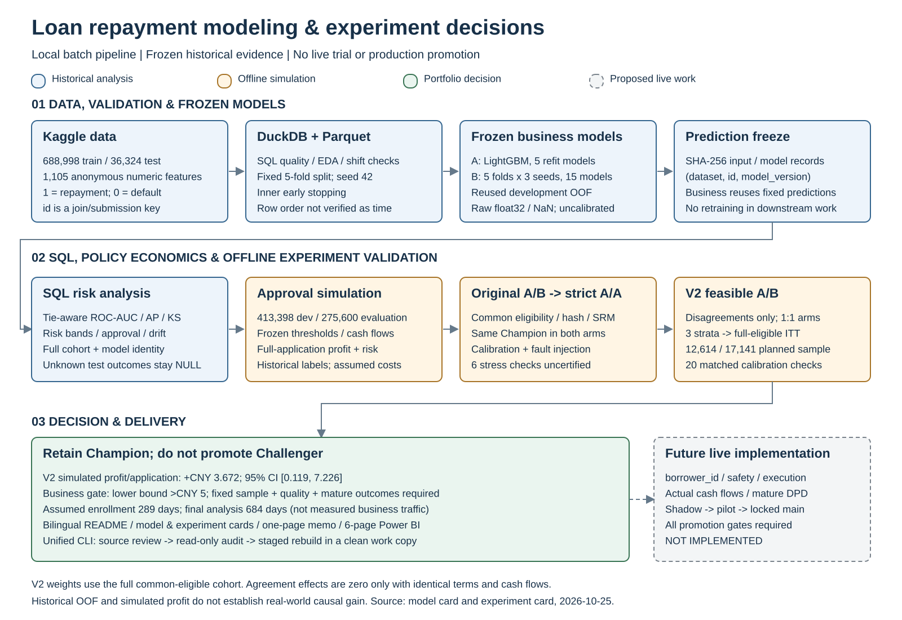

# 大规模贷款还款预测与风险实验决策

[English](README.en.md) · [交付导航](docs/INDEX.md) · [复现指南](docs/reproducibility.md)

基于 Kaggle [Large-Scale Loan Repayment Modeling Challenge](https://www.kaggle.com/competitions/large-scale-loan-repayment-modeling-challenge) 的本地项目：从大规模匿名数值数据、Python 模型和 SQL 风险分析，推进到审批收益模拟、严格 A/A 校验、A/B 可行性设计和 Power BI 决策展示。

**最终业务决定：保留 Champion，暂不晋级 Challenger。** Challenger 的历史 OOF 排序指标有所改善，但 V2 离线收益区间下界未超过 5 元业务门槛，固定样本不足，也没有真实随机实验和成熟现金流。本项目交付的是可核验的离线分析与实验设计。

## 核心结果与口径

| 指标 | Champion | Challenger / V2 | 证据范围 |
| --- | ---: | ---: | --- |
| 还款 ROC-AUC | 0.816569 | 0.820395 | 688,998 个训练申请的复用开发 OOF |
| 违约 PR-AUC（AP） | 0.388912 | 0.395367 | 同一历史 OOF；正类为违约 |
| KS | 0.472156 | 0.479461 | 同一历史 OOF |
| 冻结策略审批率 | 70.0599% | 70.0399% | 275,600 个全评价申请 |
| 冻结策略模拟收益/申请 | 276.357 元 | 279.856 元 | 历史标签 + 明确现金流假设 |
| V2 收益差及 95% 区间 | 基准政策 A | +3.672 元；[0.119, 7.226] | 换算到完整共同合格人群的分层独立组演练 |
| 分歧随机样本 | — | 12,614 / 规划 17,141 | 历史离线样本；未达到规划量 |
| 假设实验周期 | — | 入组 289 天；最终分析 684 天 | 每日 5,000、合格 20%、分歧全量入组 |

全评价配对收益差约 +3.499 元与 V2 的 +3.672 元使用不同人群和估计方法。模型指标不是 Kaggle 无标签测试 AUC；这里只引用本地已有证据，不记录未经核验的实时榜单排名。[可机器读取的事实与源哈希](docs/project_facts.json)供核对。

## 展示的能力

- **Python / 机器学习：**固定五折、内部早停、LightGBM 基线与三种子集成、缺失/漂移诊断、磁盘缓存和模型核查；另保留 XGBoost/CatBoost 等探索记录。
- **SQL / 数据工程：**DuckDB 查询大型 CSV、Parquet 转换、质量与漂移表、同分处理的 AUC/AP/KS、风险分箱、审批与实验指标。
- **业务分析：**冻结阈值、审批约束、拒绝成本、利息/LGD/资金成本情景和完整人群收益。
- **实验设计：**标签盲分流、SRM、严格 A/A、故障注入、边界校准、分层 ITT、样本量/周期、固定终点和联合晋级条件。
- **交付治理：**SHA-256 冻结、模型卡/实验卡、一页决策备忘录及六页原生 Power BI 项目。

## 数据与模型

训练集 688,998 行、1,107 列；测试集 36,324 行、1,106 列；模型使用 1,105 个匿名数值特征。`label=1` 为全额偿还、`label=0` 为违约；提交 `p_repay`，`p_default=1-p_repay`。`id` 只关联和提交，不进入模型；训练/测试 ID 可重叠，因此预测主键为 `(dataset, id, model_version)`。

官方训练/测试为时间切分，但训练文件的行号没有被验证为时间轴。项目采用 seed 42 的固定五折分层划分，训练内部划分早停集，外层生成 OOF；开发 OOF 已被多轮复用。原始 NaN 保留，零不作为缺失，LightGBM 输入为 float32，无人工标准化或概率校准。

业务冻结的 **Champion** 是 `lightgbm_baseline`（五折）；**Challenger** 是 `lightgbm_tuned_seed_ensemble`（五折 × seeds 42/2026/3407）。Kaggle 探索模型与本次冻结业务角色分别管理。完整细节见[模型卡](docs/model_card.md)和[实验卡](docs/experiment_card.md)。

## 架构



[架构说明和 Mermaid 源码](docs/architecture.md)列出数据层、依赖顺序、冻结边界与尚未实施的真实实验链路。

## 快速审阅与复现入口

从项目根目录运行；文档入口只需要 Python 3.11+，当前审阅环境为 Windows 11 / Python 3.13.11：

```powershell
python scripts/project.py status
python scripts/project.py doctor --profile docs
python scripts/project.py verify --scope docs
python scripts/project.py reproduce --target business --dry-run
```

安装完整运行依赖：

```powershell
python -m venv .venv
.\.venv\Scripts\python.exe -m pip install -r requirements.txt
.\.venv\Scripts\python.exe scripts/project.py doctor --profile analysis
.\.venv\Scripts\python.exe scripts/project.py test --scope delivery
.\.venv\Scripts\python.exe scripts/project.py verify --scope dashboard
```

`requirements-lock.txt` 与[环境快照](docs/environment_snapshot.json)记录当前环境；历史训练使用 NumPy 2.5.3，当前环境为 2.5.4，不能承诺跨环境重训练位级一致。PDF 重建还需要 requirements 中的 reportlab/pypdf；历史 PDF 使用独立文档运行时生成。

分阶段重建使用 `project.py reproduce --target data|models|business|dashboard`。**每次只运行选定阶段，前置阶段不会隐式执行。** `--dry-run` 仅打印命令；去掉后会实际运行。原始 CSV 需自行从竞赛下载并放在根目录的 `train.csv`、`test.csv`、`sample_submission.csv`；当前本地 train/test CSV 缺失，但 Parquet、冻结模型及业务结果在本地可用。重训练和完整模拟可能耗时，具体依赖及命令见[复现指南](docs/reproducibility.md)。

## Power BI 与主要交付物

打开 [LoanRisk.pbip](dashboard/powerbi/LoanRisk.pbip)，点击“主页 → 刷新”。六页包含决策总览、模型历史表现、审批策略、A/A、A/B 可行性和收益/数据缺口。移动项目后先修改 Power Query 的 `DataFolder` 为本机 `dashboard/powerbi/data` 绝对路径。

用户已确认 Desktop 2.159.883.0 的主页面刷新后正常显示；其余五页尚未逐页确认。流量/合格占比/分歧入组控件只改周期假设，固定收益、5 元门槛和晋级决定不随控件变化。详见[Power BI 使用说明](docs/powerbi_dashboard.md)。

| 交付物 | 入口 |
| --- | --- |
| 模型卡 / Model card | [中文](docs/model_card.md) · [English](docs/model_card.en.md) |
| 实验卡 / Experiment card | [中文](docs/experiment_card.md) · [English](docs/experiment_card.en.md) |
| 架构与复现 | [架构](docs/architecture.md) · [复现](docs/reproducibility.md) |
| SQL 与字段字典 | [SQL 脚本](sql) · [业务数据字典](docs/sql_business_data_dictionary.md) |
| 一页决策备忘录 | [Markdown](docs/experiment_closeout_decision_memo.md) · [PDF](output/pdf/experiment_closeout_decision_memo.pdf) |
| 审计与结果 | [事实快照](docs/project_facts.json) · [交付核查](docs/delivery_verification.json) |

## 证据边界与真实实施缺口

**历史结果**来自复用 OOF 和已有标签；**模拟分析**依赖固定条款、现金流、IID/稳定构成和流量假设；**真实业务待验证**包括持久 borrower_id、首申请去重、安全准入、执行日志、完整人群、真实成本/现金流与成熟 DPD30/60/90。测试坏账、测试收益和真实收益/DPD 保持 NULL，不填零；匿名特征不虚构业务含义。

严格原 A/A 保留六项未认证压力检查，V2 匹配 A/A/边界共 20 项通过。未经调整五次查看的误报约 14.20%，固定终点为 4.934%。历史规划模拟联合成功频率约 0.55%，合成 +10 元备择约 90.53%；它们是条件模拟频率，不是后验概率或真实 Challenger 效果。

真实实施应先 shadow 核数据/准入，再独立 pilot，最后锁定主实验；满足业务收益、风险、固定样本、质量和成熟条件后再讨论晋级。模型服务、真实随机实验、线上收益、概率校准、生产安全审批及对外发布尚未完成。本地目录尚未初始化 Git；本次交付提供可入库的文档和忽略规则，未发布数据或创建远程仓库。
