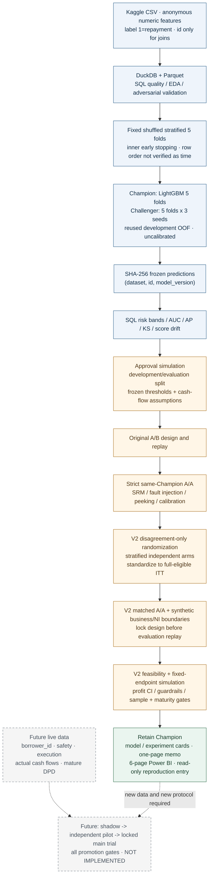

# 项目架构 / Project architecture

[交付导航](INDEX.md) · [模型卡](model_card.md) · [实验卡](experiment_card.md) · [复现指南](reproducibility.md)

项目是一条本地批处理链路：从匿名 Kaggle 数据生成固定 OOF，再将预测冻结为 SQL/策略/实验输入。后续阶段复用冻结结果，不再训练模型。原 A/B → 严格 A/A → V2 保留版本演进；新估计器必须有匹配校准，旧 A/A 不能直接认证 V2。

[PNG 版本](figures/architecture.png) · [可重绘图源](../scripts/render_project_architecture.py)

## 可编辑 Mermaid 源码

## 依赖、分母和冻结边界

| 层 | 主实现 / 输入 | 输出及边界 |
| --- | --- | --- |
| 数据与验证 | `scripts/init_duckdb.py` 至 `build_validation_strategy.py` | Parquet、质量/漂移报告、固定折号；无可信真实时间列 |
| 模型 | 线性 → LightGBM → 有限候选/多种子 | 训练 OOF、无标签测试预测、训练签名；开发 OOF 被复用 |
| SQL | 两套模型预测及模型文件来源 | SHA-256 冻结、风险分箱和模型指标；未知测试标签/收益为 NULL |
| 策略 | 冻结预测、`approval_policy_simulation.json` | 开发 413,398 / 评价 275,600；阈值、固定成本/收益、政策交接 |
| 原实验 / A/A | 策略交接、相同 Champion 执行 | 原方案规划、误报/停止规则、压力边界；保持原记录 |
| V2 | 原共同合格人群、预分析锁、分歧方向与风险层 | 实际随机分歧 12,614、完整合格评价 210,856；按完整 ITT 权重推断；规划 17,141 |
| 展示与交付 | 冻结汇总/审计、23 张聚合表 | Power BI、事实快照和卡片；收益是模拟，真实晋级未完成 |

图中的数据流不代表已部署实时服务。当前没有客户级身份、真实成熟现金流或生产审批系统；未来链路以虚线表示。

冻结文件同时约束父输入、配置/代码及结果。`project.py reproduce --target business` 对已有冻结阶段执行只读核查；数据/模型重建会改动业务父来源，所以在有业务冻结的当前工作副本中阻止执行。新数据/模型/政策版本应在干净工作副本生成新证据，不能改写旧冻结清单来通过检查。

## English reading note

Blue blocks are historical data/model analysis. Amber blocks are offline experiments with assumed cash flows. Green is the retained-Champion decision and portfolio delivery. Dashed gray blocks are proposed live implementation, which has not happened. V2 randomizes disagreements only but estimates profit at the **full common-eligible ITT denominator**, requiring agreement policies to have identical terms and cash flows.
