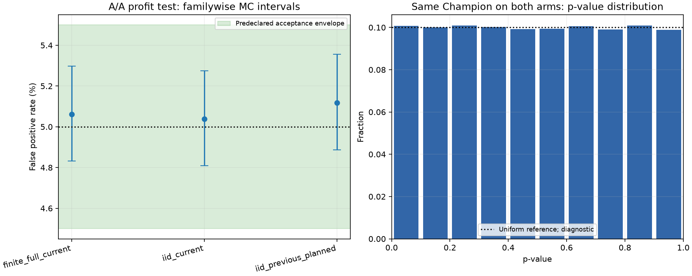
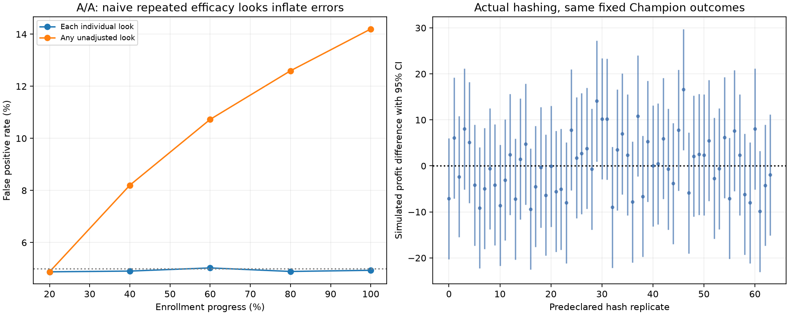

# 严格 A/A 离线校验：Champion 保留与实验管线校准

## 结果与治理决定

已完成同一 Champion 的 A/A 管线校验、真实哈希重复、零效应假阳性率与区间覆盖率、SRM 校准、独立组 Bootstrap、负向控制和停止逻辑演练。
**Champion 保留，Challenger 暂不晋级；本轮没有优化 A/B 方案、重新选择阈值或重做 Challenger 对照。**
主实验场景的离线 A/A 校验通过状态为 **True**，必检场景校准通过状态为 **True**。
这是针对当前历史分布及统计实现的离线校验，不是线上 A/A、业务安全证明或真实因果实验。

两组内部仍使用 `A/B` 字段以复用现有代码，展示时理解为 A1/A2；两组均为
**lightgbm_baseline，阈值 0.9247938423619432**。
每一申请两组的处理分数、审批决定和潜在现金流完全相同；逐申请潜在收益差为零。
原 A/B 的共同入组资格与分数层保持固定。原 `score_b` 仅为冻结的入组协变量，
本轮 B 组实际处理分数 `treatment_score_b` 与 Champion 分数完全相同。

## 1. 一次完整管线 A/A

使用代理合格的策略评价 **210,856** 行。开发行和无标签测试行不进入实验分组。
SHA256 分流概率、共享准入范围、分数层、ITT 全申请分母沿用原协议；两组借贷现金流均来自 Champion。
获批还款/违约/拒绝收益仍为 690/-8510/-10 元，收回本金不是收益，拒绝成本进入主指标。
真实 DPD、客户标识和成熟日期仍不可观测，不填零或伪造。

| experiment_id | arm | randomized_applications | approved_applications | approval_rate | simulated_default_events | simulated_default_incidence_itt | simulated_default_rate_approved | simulated_repayment_rate_approved | simulated_net_profit | simulated_profit_per_randomized_application_itt | simulated_profit_variance | actual_dpd30_rate | simulation_only |
| --- | --- | --- | --- | --- | --- | --- | --- | --- | --- | --- | --- | --- | --- |
| champion_aa_offline_v1 | A | 105659 | 96487.00 | 91.32% | 2997.00 | 2.84% | 3.11% | 96.89% | 38911910.00 | 368.28 | 2339852.51 | n.a. | True |
| champion_aa_offline_v1 | B | 105197 | 96139.00 | 91.39% | 3071.00 | 2.92% | 3.19% | 96.81% | 37992130.00 | 361.15 | 2404956.14 | n.a. | True |

一次独立组 Welch 模拟差值为 **-7.13 元**，95% 区间 **[-20.27, 6.02]**，p=0.2881。
一次不显著不能证明管线可靠；零效应下也允许按预定概率出现显著结果，不要求每个随机种子都不显著，也不挑选“好看”的盐值。
配对零差只检查两组策略身份一致，不作为独立组 SE、功效、p 值或有效置信区间的依据。
独立组 Bootstrap 稳健性演练：

| method | estimate | ci_low | ci_high | repetitions | paired_zero_not_used_for_inference |
| --- | --- | --- | --- | --- | --- |
| independent_arm_aa_bootstrap | -7.126 | -20.329 | 5.633 | 2000 | True |

## 2. 分流与协变量质量

| risk_stratum | n_total | n_a | n_b | expected_b_fraction | actual_b_fraction | srm_p_value | srm_alpha | srm_flag |
| --- | --- | --- | --- | --- | --- | --- | --- | --- |
| all | 210856 | 105659 | 105197 | 50.00% | 49.89% | 0.315407 | 0.001000 | False |
| S1 | 24235 | 12109 | 12126 | 50.00% | 50.04% | 0.918140 | 0.001000 | False |
| S2 | 42611 | 21451 | 21160 | 50.00% | 49.66% | 0.160058 | 0.001000 | False |
| S3 | 75193 | 37585 | 37608 | 50.00% | 50.02% | 0.936055 | 0.001000 | False |
| S4 | 68817 | 34514 | 34303 | 50.00% | 49.85% | 0.423411 | 0.001000 | False |

本次单一快照对整体和分层 SRM 共 5 次检查，采用 Bonferroni 阈值
0.000200 控制其家族误报率；原表的 `srm_flag` 仍保留原逐项阈值，不能与家族规则混用。
分组前协变量的标准化均值差仅作为质量检查，阈值 |SMD|≤0.10。
不使用标签进行分层、配额调整或重新分组。

| covariate | mean_a | mean_b | standardized_mean_difference |
| --- | --- | --- | --- |
| score_a | 0.961824 | 0.961885 | 0.002688 |
| common_score | 0.959522 | 0.959577 | 0.002269 |

真实哈希重复 **64 次**，每个盐值均调用原 `assign()`，重新核验键、组概率、同一政策与现金流；
收益检验 p<0.05 共 **2 次**，按零效应 5% 的精确二项一致性 p=0.7721。
64 次真实哈希只是实现抽查，误报率精度有限，不能单独宣称“误报率严格等于 5%”。
所有预声明盐值均记录，不按结果剔除或重抽。

## 3. 重复零效应统计校准

每个场景 **100,000 次**。所有分布来自同一 Champion，禁止使用不同策略分布再减去均值差冒充 A/A。

必检场景：固定当前评价总体的 Bernoulli 随机化；同一 Champion 经验分布的独立组当前规模；同一分布的原 A/B 规划规模。
有限总体模拟对每个相同现金流/审批/违约事件单元抽 B 组二项人数，A 为互补人数，等价于理想独立 Bernoulli 逐行分流；
它不会重跑 SHA256，因此与真实哈希抽查分开报告。
独立组场景分别从同一 Champion 经验分布有放回抽样，固定组人数近似规划比例。模拟比历史规模大不意味着新增真实客户。

收益使用与原代码一致的 Welch 检验；审批率和 ITT 违约发生率用原护栏标准误对应的双侧零差 Wald 检验。
这是 equality 零效应校准；原非劣效护栏的零差位于备择内部，护栏通过率不能冒充其边界 Type I error 校准。
本轮没有证明非劣效边界检验、相关客户/时间数据或未来优化估计器已经校准。

检验水平 1%、5%、10%；可接受假阳性率偏离分别为 ±0.3、±0.5、±0.7 个百分点。
每一项用 Clopper–Pearson 精确二项区间，并对全部场景/端点/alpha/SRM 检查进行 Bonferroni 校正，
同时置信水平至少 95%。
只有整个区间落入预声明容许范围且没有无效重复，才认证该场景；不能只看点估计或发现不显著就宣布通过。
区间覆盖率是相应零差检验接受率的补数，不是第二份独立证据。

5% 水平的必检结果：

| case_id | endpoint | n_total | false_positive_rate | fpr_simultaneous_ci_low | fpr_simultaneous_ci_high | zero_effect_interval_coverage | calibration_passed |
| --- | --- | --- | --- | --- | --- | --- | --- |
| finite_full_current | profit_itt | 210856 | 5.06% | 4.83% | 5.30% | 94.94% | True |
| finite_full_current | approval_rate | 210856 | 4.98% | 4.75% | 5.22% | 95.02% | True |
| finite_full_current | default_incidence_itt | 210856 | 5.00% | 4.78% | 5.24% | 94.99% | True |
| iid_current | profit_itt | 210856 | 5.04% | 4.81% | 5.28% | 94.96% | True |
| iid_current | approval_rate | 210856 | 4.99% | 4.76% | 5.23% | 95.01% | True |
| iid_current | default_incidence_itt | 210856 | 5.06% | 4.83% | 5.30% | 94.94% | True |
| iid_previous_planned | profit_itt | 3721531 | 5.12% | 4.89% | 5.36% | 94.88% | True |
| iid_previous_planned | approval_rate | 3721531 | 4.99% | 4.76% | 5.22% | 95.01% | True |
| iid_previous_planned | default_incidence_itt | 3721531 | 5.10% | 4.87% | 5.34% | 94.90% | True |

SRM 的有限总体二项校准：

| case_id | repetitions | nominal_srm_alpha | false_srm_flags | false_srm_flag_rate | simultaneous_ci_low | simultaneous_ci_high | upper_limit | calibration_passed |
| --- | --- | --- | --- | --- | --- | --- | --- | --- |
| finite_full_current | 100000 | 0.10% | 104 | 0.10% | 0.07% | 0.14% | 0.20% | True |

压力场景仅用于识别使用限制，未被事后移除或混入“全部通过”的说法；未认证可能是失准或区间不足以证明精度。

| case_id | endpoint | n_total | false_positive_rate | fpr_simultaneous_ci_low | fpr_simultaneous_ci_high | zero_effect_interval_coverage | calibration_passed |
| --- | --- | --- | --- | --- | --- | --- | --- |
| stress_n10000_r0.1 | profit_itt | 10000 | 5.54% | 5.30% | 5.78% | 94.46% | False |
| stress_n10000_r0.1 | approval_rate | 10000 | 5.20% | 4.96% | 5.43% | 94.80% | True |
| stress_n10000_r0.1 | default_incidence_itt | 10000 | 5.49% | 5.25% | 5.74% | 94.51% | False |
| stress_n10000_r0.5 | profit_itt | 10000 | 4.89% | 4.67% | 5.13% | 95.11% | True |
| stress_n10000_r0.5 | approval_rate | 10000 | 5.07% | 4.84% | 5.30% | 94.94% | True |
| stress_n10000_r0.5 | default_incidence_itt | 10000 | 4.90% | 4.67% | 5.13% | 95.10% | True |
| stress_n50000_r0.1 | profit_itt | 50000 | 5.19% | 4.96% | 5.43% | 94.81% | True |
| stress_n50000_r0.1 | approval_rate | 50000 | 5.03% | 4.80% | 5.27% | 94.97% | True |
| stress_n50000_r0.1 | default_incidence_itt | 50000 | 5.16% | 4.92% | 5.39% | 94.84% | True |
| stress_n50000_r0.5 | profit_itt | 50000 | 4.95% | 4.72% | 5.19% | 95.05% | True |
| stress_n50000_r0.5 | approval_rate | 50000 | 5.03% | 4.80% | 5.26% | 94.97% | True |
| stress_n50000_r0.5 | default_incidence_itt | 50000 | 4.97% | 4.74% | 5.20% | 95.03% | True |

完整 1%/5%/10% 表与 p 值分箱见 CSV。p 值直方图以均匀分布为诊断参考；离散性/近似检验会影响形状，不单凭图形认证。

## 4. 负向控制与停止逻辑

| control | detector | detected_as_expected |
| --- | --- | --- |
| changed_arm_b_cashflow | independent_identity_and_assignment_validation | True |
| label_dependent_allocation | independent_identity_and_assignment_validation | True |
| duplicate_application_key | independent_identity_and_assignment_validation | True |
| label_dependent_eligibility | independent_identity_and_assignment_validation | True |
| fabricated_zero_dpd | independent_identity_and_assignment_validation | True |
| wrong_declared_assignment_probability | independent_identity_and_assignment_validation | True |
| wrong_experiment_identity | independent_identity_and_assignment_validation | True |
| corrupted_stored_outcome_label | independent_identity_and_assignment_validation | True |
| corrupted_preassignment_stratum | independent_identity_and_assignment_validation | True |
| biased_allocation_vs_declared_probability | independent_identity_and_assignment_validation | True |
| srm_detects_injected_bias | exact_binomial_srm | True |
| approved_only_denominator_bug | independent_itt_metric_validation | True |
| profit_test_detects_injected_effect | welch_profit_test | True |
| early_efficacy_blocked | readiness_gate | True |
| immature_outcomes_blocked | readiness_gate | True |
| insufficient_sample_blocked | readiness_gate | True |
| unresolved_srm_blocked | readiness_gate | True |

故意注入 B 组收益偏移、55% 分流、标签决定分组/准入、重复 ID、伪造 DPD 与获批口径分母，确认相应核查能拒绝错误。
这些是隔离的故障注入测试，不进入实际 A/A 快照、不用于政策收益分析。
注入 +50 元仅测试收益检验敏感性，不是本轮优化目标或新的 MDE。

停止规则负向控制分别检查样本不足、未成熟、SRM 未解决和提前收益分析。
当前真实分析就绪始终为 false：历史没有成熟日期，当前规模也未达到原固定样本量。
安全暂停可保留；提前安全暂停不授权提前宣布收益成功。

在同一零效应流量上演练未经调整的 5 次查看，使用累计样本，而不是 5 次独立实验：

| look_fraction | n_total | repetitions | single_look_two_sided_fpr | naive_any_look_two_sided_fpr | single_look_positive_ci_rate | naive_any_look_positive_ci_rate | nominal_two_sided_alpha | nominal_positive_direction_alpha | allowed_efficacy_look | simulation_only |
| --- | --- | --- | --- | --- | --- | --- | --- | --- | --- | --- |
| 20.00% | 20000 | 50000 | 4.88% | 4.88% | 2.36% | 2.36% | 0.0500 | 0.0250 | False | True |
| 40.00% | 40000 | 50000 | 4.90% | 8.20% | 2.36% | 3.94% | 0.0500 | 0.0250 | False | True |
| 60.00% | 60000 | 50000 | 5.03% | 10.73% | 2.52% | 5.23% | 0.0500 | 0.0250 | False | True |
| 80.00% | 80000 | 50000 | 4.89% | 12.59% | 2.45% | 6.18% | 0.0500 | 0.0250 | False | True |
| 100.00% | 100000 | 50000 | 4.93% | 14.20% | 2.48% | 7.00% | 0.0500 | 0.0250 | True | True |

双侧错误与“B 正向区间超过零”错误分别对应 5% 与 2.5% 单次名义水平，不混淆二者。
这张表演示可选停止的危害，不为真实实验引入任何未经 alpha 分配的中期收益检验。

## 5. 边界与后续

SQL、键/概率、逐行现金流、零效应模拟和预声明校验规则可核验，不等于证明真实准入、客户去重、现金流成熟或生产风险。
Kaggle 申请行无法识别重复客户，既有 OOF 多轮用于开发；校准条件于固定历史分布，不覆盖未知相关性、选择偏差、未校准分数和未来漂移。
测试全体审批率约 17%、原共同代理测试覆盖率约 23% 的漂移问题仍然存在。
本轮治理文件 `model_governance_decision.json` 记录保留 Champion；未来优化 A/B 时若换估计器、目标人群、分组或停止规则，应重新做匹配的 A/A 校准。
下一步 A/B 可行性优化与重新模拟尚未执行。

复现：`docs/aa_validation.md`。数据库 `data/interim/aa_validation.duckdb`；13 份 CSV、快照/重复样本 Parquet、两张图与冻结清单。
