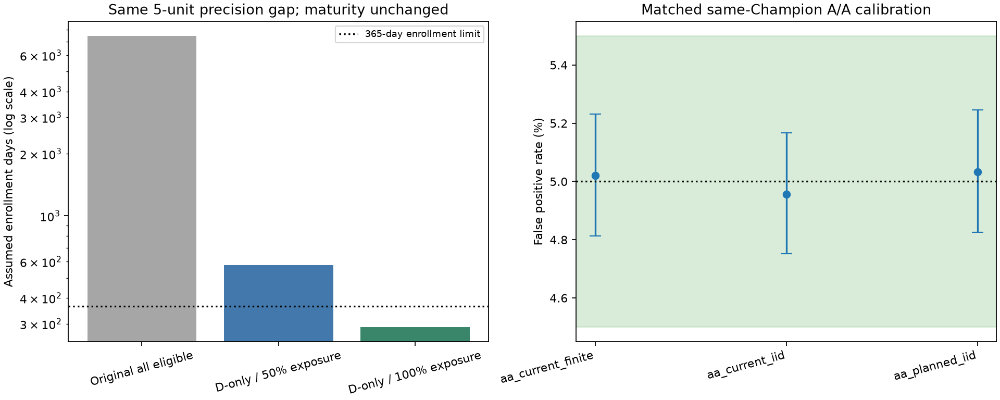
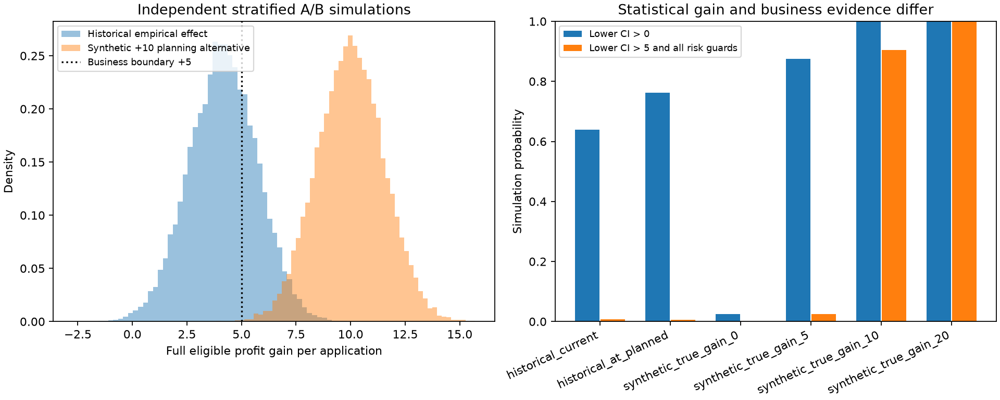

# A/B 可行性优化与新方案离线模拟

## 结论

新方案已完成匹配的 A/A 与边界校准、固定盐值实际分流及新的 A/B 模拟。Champion 继续保留，Challenger 不晋级。
匹配校准全部通过：**True**。本轮属于固定历史标签和假设现金流的离线设计，未完成真实因果实验或生产安全验证。

原方案需 3,721,531 个随机申请，原假设下入组 7,444 天。
新方案需 **17,141 个分歧申请**，在每日 5,000 申请、共同合格占比 20% 的原流量假设下，
选用合格分歧申请 100% 暴露、A:B=1:1，预计入组 **289 天**。
成熟期仍为 365 天，宽限 30 天；最终分析约 **684 天**，并未变成短周期贷款实验。
这是条件可行性，不是已确认流量或上线批准；低流量情景仍可能不可行。

## 1. 业务问题和成功契约

主问题：新政策在完整共同合格申请人群的平均净收益，是否比 Champion 高出 **5 元/申请**以上？
主检验 H0: Δ收益≤5；使用 95% 双侧区间的下界>5，等价于单侧 α=2.5%。下界>0 仅为次级描述。
规划备择为 Δ=10，距离业务边界仍为 5 元，边际功效 80%，方差安全系数 1.25；未通过放宽收益门槛或风险护栏来改善可行性。
原 MDE=5 针对零差，不是证明 Δ>5 的 80% 功效点。真值恰好为 5 时，业务成功误报上限应是 2.5%，不是 80%。

保持 ITT 违约发生率非劣效界值 0.2 个百分点、审批率降幅界值 2 个百分点、完整 B 获批组合违约率上界 5%。
联合成功率单独模拟，不把各项边际 80% 功效当作联合 80% 保证。

## 2. 分歧随机化和完整人群估计

原共同代理 gate `min(score_A,score_B)>=0.90`、模型与完整精度阈值保持冻结。
在 gate 内仅对两政策审批不同的申请随机化；标签不决定准入、方向、分层、比例或盐值。
随机分组前已可观测的 `risk_stratum × 审批分歧方向` 用于分析分层，1:1 稳定 SHA256 Bernoulli 分流。
这不是精确区组平衡；组内实际样本数及 SRM 必须核查。未来需要持久借款人 ID、首个申请和独立 pilot。

完整人群效应估计为 `Σ_h (N_h/N_eligible) × (mean_B,h−mean_A,h)`，独立组方差为
`Σ_h weight_h² × (var_A,h/n_A,h + var_B,h/n_B,h)`，收益用 Satterthwaite 自由度。
权重来自同时期全体合格申请的分组前协变量普查，分层内所有随机申请都进入分母；未用历史配对差值方差规划随机组样本。
规划权重和方差仅取 policy_development；评价/测试协变量漂移单独报告，不按评价收益重新选样本或参数。

两策略决策一致的申请继续 Champion。在本项目固定条款/费用/现金流假设下，其政策效应逐申请严格为零，
故排除这些申请不丢失政策收益对照信号。若真实模型改变额度、价格、条款、服务或共同申请行为，这个恒等前提失效，必须重新设计完整随机化。
分歧样本上的较大收益差不能直接当作全体收益；上述权重把问题保持在原完整共同合格范围。
新方案约改变 2.97% 合格申请的审批；原协议实际决策改变暴露约 1.49%。
全部分歧进入实验并不表示风险已获验证，其决策改变暴露高于原正式流量假设，仍需 shadow/pilot 安全审核。

审批率差由两冻结政策在完整协变量普查上的决定直接计算，没有必要用随机分组噪声检验已知决定。
违约差使用全人群加权独立组估计。完整 B 获批违约率上界由一致批准组合和 B 分歧批准单元的
Clopper–Pearson 单侧上界按 Bonferroni 联合后加权，再除以已知完整 B 批准比例；同时纳入一致组合的风险不确定性。
这是完整组合的原风险上限，不能套用分歧批准子集比率冒充完整组合。局部高风险仍须业务审核，真实 DPD 保持 NULL。

## 3. 开发阶段规划及流量

候选比较与选中方案：

| design | disagreement_exposure | required_randomized | expected_eligible_arrivals | enrollment_days | randomized_fraction_of_eligible | challenger_routed_fraction_of_eligible | changed_decision_fraction_of_eligible | business_boundary | planning_true_gain | planning_gap | planning_cohort | selected | enrollment_feasible |
| --- | --- | --- | --- | --- | --- | --- | --- | --- | --- | --- | --- | --- | --- |
| original_all_eligible | 0.50 | 3721531 | 7443062.00 | 7444 | 0.50 | 0.25 | 0.01 | 5.00 | 10.00 | 5.00 | policy_development | False | False |
| disagreement_stratified | 0.50 | 17141 | 576821.52 | 577 | 0.03 | 0.01 | 0.01 | 5.00 | 10.00 | 5.00 | policy_development | False | False |
| disagreement_stratified | 1.00 | 17141 | 288410.76 | 289 | 0.06 | 0.03 | 0.03 | 5.00 | 10.00 | 5.00 | policy_development | True | True |

开发方差、完整权重和必要的最小单元数在 planning_strata.csv 与 design_protocol.json。
正式入组固定 N=17,141；每单元每组至少 100 个成熟有效申请作为分析质量门槛。
比例与分层漂移或质量不达标时，保留 Champion，重新规划独立的新实验；不得看收益后继续加样本。
样本量同时考虑收益、相对违约护栏和最小单元；绝对风险与所有门槛的联合功效由下表实测，不作边际功效替代。

原全人群独立组正态比较需约 372 万，是相同 5 元精度间隔的参照；原成功规则与本轮严格业务边界检验不同。
原审批/模型/现金流和冻结产物未改。流量、合格占比和成熟期均为模拟假设，测试没有标签；
测试协变量只用于覆盖与流量敏感性，不提供未来收益或安全结论。

| dataset | policy_cohort | applications | common_eligible | disagreements | agreements | approved_a | approved_b | disagreement_fraction_of_all | disagreement_fraction_of_eligible | simulation_only |
| --- | --- | --- | --- | --- | --- | --- | --- | --- | --- | --- |
| test | unlabeled_test | 36324 | 8267 | 557 | 7710 | 6178 | 6189 | 1.53% | 6.74% | True |
| train | policy_development | 413398 | 316106 | 18787 | 297319 | 288710 | 288651 | 4.54% | 5.94% | True |
| train | policy_evaluation | 275600 | 210856 | 12614 | 198242 | 192626 | 192540 | 4.58% | 5.98% | True |

全部流量情景见 experiment_duration.csv，包括低流量不可行、测试分歧比例敏感性及完整成熟周期。

## 4. 修改统计实现后的匹配校准

每个校准场景 100,000 次：当前有限总体、当前规模 IID、规划规模 IID 三个同 Champion A/A；
另有 Δ收益=5 和 Δ违约发生率=0.002 的统计边界校准。边界场景调整 B 批准单元的二项违约概率，
是明确标识的合成压力测试，不是同策略 A/A，也不是真实政策表现。
同策略 A/A 校准收益和违约的双侧零差；审批决定在分层内相同，只作恒等检查，不对零方差制造 p 值。
收益业务边界、非劣效边界则分别校准单侧 2.5% 的错误成功概率，修补上一轮尚未完成的边界验证。
全部 20 项同时 Clopper–Pearson 区间落入预先配置的容许范围才通过，不挑盐值或剔除失败场景。

| case_id | endpoint | alpha | repetitions | valid_repetitions | rejections | false_positive_rate | simultaneous_ci_low | simultaneous_ci_high | acceptance_low | acceptance_high | passed | genuine_same_champion_aa | synthetic_boundary |
| --- | --- | --- | --- | --- | --- | --- | --- | --- | --- | --- | --- | --- | --- |
| aa_current_finite | profit_equality | 1.00% | 100000 | 100000 | 1015 | 1.01% | 0.92% | 1.11% | 0.70% | 1.30% | True | True | False |
| aa_current_finite | profit_equality | 5.00% | 100000 | 100000 | 5020 | 5.02% | 4.81% | 5.23% | 4.50% | 5.50% | True | True | False |
| aa_current_finite | profit_equality | 10.00% | 100000 | 100000 | 9878 | 9.88% | 9.59% | 10.17% | 9.30% | 10.70% | True | True | False |
| aa_current_finite | default_equality | 1.00% | 100000 | 100000 | 1018 | 1.02% | 0.92% | 1.12% | 0.70% | 1.30% | True | True | False |
| aa_current_finite | default_equality | 5.00% | 100000 | 100000 | 5021 | 5.02% | 4.81% | 5.23% | 4.50% | 5.50% | True | True | False |
| aa_current_finite | default_equality | 10.00% | 100000 | 100000 | 9886 | 9.89% | 9.60% | 10.17% | 9.30% | 10.70% | True | True | False |
| aa_current_iid | profit_equality | 1.00% | 100000 | 100000 | 1009 | 1.01% | 0.92% | 1.11% | 0.70% | 1.30% | True | True | False |
| aa_current_iid | profit_equality | 5.00% | 100000 | 100000 | 4957 | 4.96% | 4.75% | 5.17% | 4.50% | 5.50% | True | True | False |
| aa_current_iid | profit_equality | 10.00% | 100000 | 100000 | 9873 | 9.87% | 9.59% | 10.16% | 9.30% | 10.70% | True | True | False |
| aa_current_iid | default_equality | 1.00% | 100000 | 100000 | 1011 | 1.01% | 0.92% | 1.11% | 0.70% | 1.30% | True | True | False |
| aa_current_iid | default_equality | 5.00% | 100000 | 100000 | 4960 | 4.96% | 4.75% | 5.17% | 4.50% | 5.50% | True | True | False |
| aa_current_iid | default_equality | 10.00% | 100000 | 100000 | 9879 | 9.88% | 9.60% | 10.17% | 9.30% | 10.70% | True | True | False |
| aa_planned_iid | profit_equality | 1.00% | 100000 | 100000 | 1025 | 1.03% | 0.93% | 1.12% | 0.70% | 1.30% | True | True | False |
| aa_planned_iid | profit_equality | 5.00% | 100000 | 100000 | 5033 | 5.03% | 4.83% | 5.25% | 4.50% | 5.50% | True | True | False |
| aa_planned_iid | profit_equality | 10.00% | 100000 | 100000 | 10039 | 10.04% | 9.75% | 10.33% | 9.30% | 10.70% | True | True | False |
| aa_planned_iid | default_equality | 1.00% | 100000 | 100000 | 1028 | 1.03% | 0.93% | 1.13% | 0.70% | 1.30% | True | True | False |
| aa_planned_iid | default_equality | 5.00% | 100000 | 100000 | 5040 | 5.04% | 4.83% | 5.25% | 4.50% | 5.50% | True | True | False |
| aa_planned_iid | default_equality | 10.00% | 100000 | 100000 | 10042 | 10.04% | 9.76% | 10.33% | 9.30% | 10.70% | True | True | False |
| business_boundary_5 | business_boundary | 2.50% | 100000 | 100000 | 2455 | 2.46% | 2.31% | 2.61% | 2.10% | 2.90% | True | False | True |
| default_ni_boundary | default_ni_boundary | 2.50% | 100000 | 100000 | 2569 | 2.57% | 2.42% | 2.72% | 2.10% | 2.90% | True | False | True |

另有 32 次真实 SHA256 Champion/Champion 分流，逐行重新核验。
实际哈希重复频次精度有限，与十万次压缩单元统计校准分别记录。原 A/A 发现的 1:9 小样本未认证限制仍保存，未用来证明本方案。

## 5. 固定盐值历史 A/B 演练

| delta | se | df | ci_low | ci_high | p | default_delta | default_upper | approval_delta | business_threshold | business_value_demonstrated_in_simulation | positive_zero_ci_in_simulation | default_ni_passed | approval_ni_passed | full_portfolio_approved_default_upper | absolute_risk_passed | minimum_cell_sample_reached |
| --- | --- | --- | --- | --- | --- | --- | --- | --- | --- | --- | --- | --- | --- | --- | --- | --- |
| 3.67240 | 1.81251 | 6208.56034 | 0.11926 | 7.22555 | 0.04279 | -0.00043 | -0.00004 | -0.00041 | 5.00000 | False | True | True | True | 0.03222 | True | True |

完整合格申请收益差 **+3.672 元**，95% 区间 **[0.119, 7.226]**。
下界>0：True；下界>5：False。
不能把零差显著或更精确的区间当作已满足收益业务门槛。

独立分层 Bootstrap：

| method | estimate | ci_low | ci_high | repetitions |
| --- | --- | --- | --- | --- |
| independent_within_stratum_full_population_weighted | 3.672 | 0.086 | 7.267 | 2000 |

总体及单元 SRM：

| stratum | n | n_a | n_b | srm_p | srm_familywise_cutoff | passed |
| --- | --- | --- | --- | --- | --- | --- |
| all | 12614 | 6264 | 6350 | 0.449159 | 0.000250 | True |
| S1_A_approves_B_rejects | 5872 | 2896 | 2976 | 0.302568 | 0.000250 | True |
| S1_A_rejects_B_approves | 6264 | 3128 | 3136 | 0.929524 | 0.000250 | True |
| S2_A_approves_B_rejects | 478 | 240 | 238 | 0.963525 | 0.000250 | True |

收益真值取评价经验分布与预先列出的合成备择；均为独立组有放回未来样本模拟。
合成 +10 等用于检验设计能力，不能写成 Challenger 的收益。历史分布的大规模重采样不会创造新增客户证据。

| case_id | n_disagreements | true_profit | business_value_rate | business_value_mc_low | business_value_mc_high | positive_zero_rate | default_ni_rate | approval_ni_rate | absolute_risk_rate | joint_success_rate | joint_success_mc_low | joint_success_mc_high |
| --- | --- | --- | --- | --- | --- | --- | --- | --- | --- | --- | --- | --- |
| historical_current | 12614 | 4.165 | 0.73% | 0.61% | 0.85% | 63.95% | 100.00% | 100.00% | 100.00% | 0.73% | 0.61% | 0.85% |
| historical_at_planned | 17141 | 4.165 | 0.55% | 0.45% | 0.66% | 76.31% | 100.00% | 100.00% | 100.00% | 0.55% | 0.45% | 0.66% |
| synthetic_true_gain_0 | 17141 | -0.000 | 0.00% | 0.00% | 0.02% | 2.46% | 100.00% | 100.00% | 100.00% | 0.00% | 0.00% | 0.02% |
| synthetic_true_gain_5 | 17141 | 5.000 | 2.48% | 2.27% | 2.71% | 87.46% | 100.00% | 100.00% | 100.00% | 2.48% | 2.27% | 2.71% |
| synthetic_true_gain_10 | 17141 | 10.000 | 90.53% | 90.11% | 90.93% | 100.00% | 100.00% | 100.00% | 100.00% | 90.53% | 90.11% | 90.93% |
| synthetic_true_gain_20 | 17141 | 20.000 | 100.00% | 99.98% | 100.00% | 100.00% | 100.00% | 100.00% | 100.00% | 100.00% | 99.98% | 100.00% |

## 6. 执行与责任边界

先 shadow 验证目标协变量覆盖、分歧方向、共同安全准入及持久客户去重，再进行独立 pilot 的安全暂停演练。
满足安全条件后开启固定样本正式实验；正式样本不混入 pilot，分歧曝光按锁定计划执行，其他申请沿用 Champion 并保留实际成熟风险账本。
只允许固定终点、全体结果成熟、质量通过后的主分析。样本不足、单元不足、SRM 未解决、现金流未成熟或 DPD 缺失都阻断生产晋级；
不得根据未经调整的中期收益显著结果提前成功或追样本。新增停止/估计器/准入变更需重新匹配校准。

开发/评价 OOF 均经过既有模型开发及前轮分析，本轮本地设计锁定不构成新的独立模型验证或外部预注册。
所有收益依赖固定历史标签和模拟条款，不能识别真实政策引起的借款行为变化、未获批人群选择偏差或宏观漂移。
真实流量、成熟结果、局部风险容忍度及客户相关性待前瞻确认；production_rollout_ready 始终 false。

复现说明见 docs/ab_feasibility_v2.md；数据库 data/interim/ab_feasibility_v2.duckdb。
保留预分析设计锁定、真实分流、匹配校准/AB/Bootstrap 重复 Parquet、SQL 表、报告、图表和最终冻结哈希。
