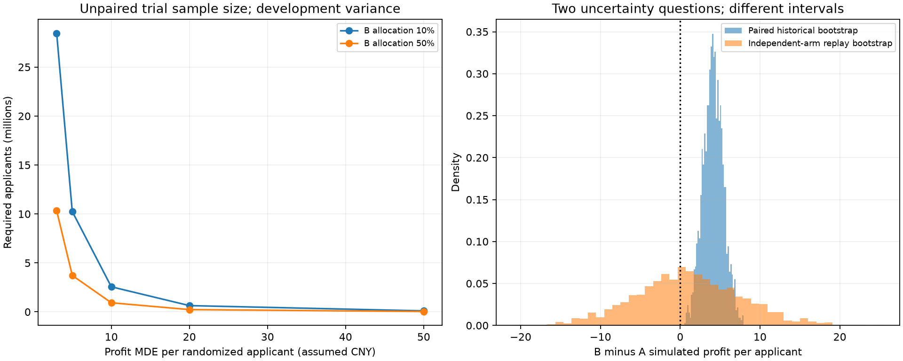
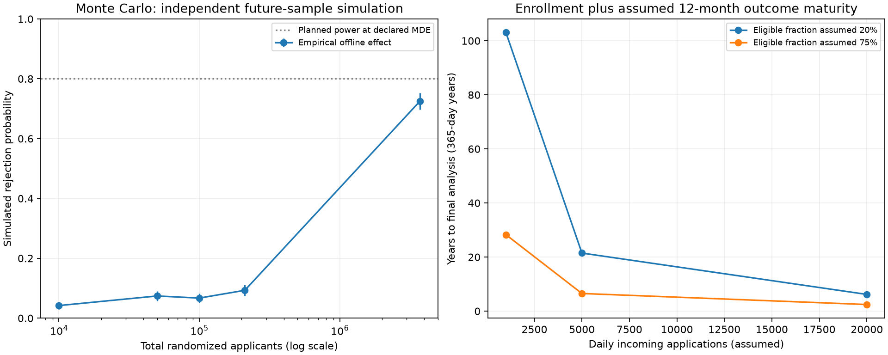

# Champion–Challenger A/B Test：方案、功效与离线演练

## 结论与交付状态

已完成实验协议设计、冻结策略接入、确定性哈希分流演示、SQL 指标、样本量/MDE、期限估算、Bootstrap 和 Monte Carlo。
**所有随机分组和收益都是历史数据上的离线模拟；没有真实客户分流，没有真实因果实验结果，也没有生产放量授权。**
共同分数代理入组范围内，历史配对模拟 B−A 为 **+4.16 元/申请**，
配对 Bootstrap 95% 区间为 **[1.70, 6.68]**。
这是条件于历史样本、固定模型及不变标签假设的配对区间，不能替代独立随机组试验的样本量或因果置信区间。

示例主指标 MDE 为 **5 元/申请**、双侧 α=5%、功效 80%。
独立 A/B 组按开发子集边际收益方差并乘 1.25 方差安全系数规划，
同时考虑违约发生率与审批率非劣效护栏，需要约 **3,721,531 个成熟可评价的随机入组申请**。
每个端点的边际功效按 80% 设计；联合通过所有条件的概率不等于 80%。
按每天 5,000 申请、20% 符合条件、
其中 50% 进入正式实验的示例流量，入组约 **7,444 天**，
再加 365 天结果成熟和 30 天数据宽限。
因此在这一流量假设下，当前几元量级的全入组人群收益差不适合承诺一年内完成验证。
这些流量、MDE 与周期是假设，不是 Kaggle 提供的业务事实。

## 1. 问题、策略和目标人群

问题：在统一准入人群、同一贷款条款与成本口径下，B 策略相对 A 是否增加每个入组申请的净收益，并守住风险与审批量约束？

| prospective_arm | model_role | model_version | target_approval_rate | threshold | decision_rule |
| --- | --- | --- | --- | --- | --- |
| A | champion | lightgbm_baseline | 70.00% | 0.924794 | score_threshold |
| B | challenger | lightgbm_tuned_seed_ensemble | 70.00% | 0.925681 | score_threshold |

假设条件沿用上一阶段：本金 10,000 元，期限 12 个月，利息 12%，LGD 80%，资金成本 4%，获批服务成本 100 元、每个申请成本 10 元。
阈值使用 Parquet 和 JSON 的完整浮点精度。这里不根据实验演练重新选择模型、阈值或经济参数。

真实入组单位拟定为**每个借款人的首个符合条件申请**；按稳定 borrower_id 持久分流，避免重复借款跨组和重复计入主指标。
Kaggle 没有 borrower_id、申请时间和真实准入记录；本次 `(dataset,id)` 是申请行的演示键，无法验证客户独立性。
样本量依赖独立单位假设，真实重复客户或群组相关性需要重新评估有效样本量。

真实实验必须先通过独立业务准入、身份与重复客户检查、预算及已验证风险范围；这些字段当前不可观测。
离线代理条件预声明为 `min(score_A,score_B) >= 0.90`，
两组使用同一条件，分组前执行；仅作为演示，未校准分数大于 0.90 不代表真实还款概率大于 90% 或业务安全已证实。
风险层边界为 [0.9, 0.925, 0.95, 0.975]；按共同分数记录，不使用标签分层。
不能仅在“两模型都批准”的客户中随机，否则审批决定相同，无法检验审批政策差异。
当前代理范围中决策分歧比例约 **5.98%**；一致决定与分歧决定都保留，拒绝申请也进入 ITT 分母。

| policy_cohort | applications | eligible_proxy_applications | eligible_proxy_fraction | eligible_disagreements | paired_historical_profit_delta |
| --- | --- | --- | --- | --- | --- |
| policy_development | 413398 | 316106 | 76.47% | 18787 | 5.95 |
| policy_evaluation | 275600 | 210856 | 76.51% | 12614 | 4.16 |
| unlabeled_test | 36324 | 8267 | 22.76% | 557 | n.a. |

共同代理入组改变了目标人群，4.16 元结果不能直接和上一阶段全体申请的 3.50 元作同口径比较。
原始固定阈值在测试全体申请上仅批准约 17%；本次共同代理覆盖率也出现明显训练—测试变化。
测试集只计算分数和入组覆盖诊断，不生成有标签实验结果，不利用测试数据调阈值或确定 MDE。

## 2. Shadow、pilot 与正式实验

1. **Shadow**：A 保持现有决策，同时计算 A/B 分数与决定并记录延迟、失败率、覆盖率、审批量、分歧人群。
   至少跨一个完整业务周期；示例两周只用于工程检查，不能验证 12 个月信用风险。
   收集目标人群成熟标签、实际成本和稳定客户标识后，重新确认范围、方差和风险基线并冻结正式协议。
2. **独立 pilot**：用单独版本/盐值随机挑选一小部分符合条件客户，内部仍 A:B=1:1；
   例如 10% 的符合条件客户进入 pilot，则 B 暴露是符合条件客户的 5%，其余执行 A。
   暴露预算、每阶段期限、风险证据由业务事先确定。早期通过工程检查不能自动证明损失风险通过。
   根据 pilot 安全结果作出后续决策时，pilot 不并入正式主检验。
3. **正式实验**：使用独立实验 ID，排除 pilot 已参与借款人；符合条件人群中预定 50% 进入正式实验，
   在正式入组者内按哈希概率 A:B=50%:50%。
   外部继续 A 的客户不混入随机对照组。曝光选择和 A/B 分组使用独立哈希域，保留持久分组。
4. **最终分析**：固定样本量达到后停止入组，等待最后入组者完成结果成熟与数据宽限，再执行一次主分析。
   不能看一次收益 p 值就宣布成功或加样本。任何提前安全暂停、策略/条款变更都应完整记录，必要时终止并另开协议。

本次离线演练对全部代理合格的策略评价行做 A/B 分组，没有伪造日历、贷款生命周期或 live pilot。
SHA256 盐值加数据集/申请键产生均匀分流，同一键顺序改变、追加新行或修改标签都不改变原分组。
这是 Bernoulli 分流，风险层用于分层质量检查，不声称实现了精确平衡区组随机化。

## 3. 指标与统计判断契约

| 类别 | 定义与用途 |
|---|---|
| 唯一主指标 | 全体随机入组申请的成熟净收益均值；拒绝申请为 −申请成本。主效应 B−A，ITT 包含所有已分组申请 |
| 核心次指标 | 审批率、获批还款率、净收益总额；获批还款率是不同批准人群的组合描述，不能单独解释为客户层面的因果改善 |
| 因果政策护栏 | 违约发生率 = 获批且违约人数/全部随机入组申请；B−A 的单侧上界须小于 0.20%（百分点差） |
| 审批量护栏 | B−A 审批率的单侧下界须大于 −2.00%（百分点差） |
| 绝对信用风险护栏 | B 获批组合违约率的单侧 Wilson 上界须 ≤ 5%；不同批准人群的安全标准，不是借款人还款因果效应 |
| 风险集中度 | 共同分数层中获批人群占比；最低分层占比相对 A 上升 5 个百分点触发审查，属于预声明的运营诊断 |
| 数据/工程护栏 | SRM、跨组客户、决策执行偏离、分数失败与延迟；SRM 阈值 0.001，触发调查并阻断结论 |
| 当前不可观测 | 30/60/90 天逾期、实际现金回收、损失时间、客户集中度；保持 NULL，真实实验需采集，不能用 label=0 代替逾期 |

主指标最终使用独立组 Welch 检验和双侧 95% 区间，预声明稳健性分析可用独立组 Bootstrap。
收益有厚尾时，还需预先检查稳定性，不能事后删除坏账或改成获批口径。
晋级需要主指标下界 >0、收益点估计达到预声明的业务价值筛选 5 元/申请、全部护栏通过、
固定样本与成熟完整、工程质量通过。点估计达到业务门槛不证明真实效果超过门槛。
MDE 是功效规划的备择效应，不是 p 值判定门槛；不能把未显著结果说成两模型等价。
全部必须通过的非劣效护栏采用单侧 α=2.5%；联合通过规则属于 intersection–union，
不从众多指标挑一个显著结果。每个端点的样本量不保证联合功效达到 80%。
风险层局部 SRM 是诊断性多次检查，不是收益假设检验或重新抽盐值的理由。

每笔贷款用同一观察期；违约和收款可能延迟。拒绝样本也保留原分组和申请成本。
借款人退出、逾期未成熟、字段缺失不能直接从 ITT 删除。固定成熟截点存在未解决结果时阻断最终晋级，
必须调查并作预声明的缺失敏感性分析，不能只分析已经还款或标签齐全的人。
本次历史标签没有时间信息，因此只按完整既有标签演练，无法完成真实成熟/缺失检查。

## 4. 样本量、MDE 与期限

连续收益规划使用策略开发范围的边际方差：

```text
Var(mean_B − mean_A) = variance_A / n_A + variance_B / n_B
N ≈ (z_(1−alpha/2) + z_power)^2 × [variance_A/(1−r) + variance_B/r] / MDE²
```

代码通过正态功效函数搜索最小整数总 N；分组人数是 Bernoulli 的预期人数，运行中还需确保两组实际成熟有效人数足够。
不使用两策略同一历史行差值的方差规划独立组试验。违约发生率和审批率非劣效样本量采用开发 A 组基线，
规划假设 B−A 为 0，分别距离各自非劣效边界一个 margin；这些护栏计算是大样本近似。

| endpoint | fraction_b | effect_or_margin | n_total | achieved_normal_power |
| --- | --- | --- | --- | --- |
| profit_superiority | 10.00% | 3.000 | 28463583 | 80.00% |
| profit_superiority | 10.00% | 5.000 | 10246890 | 80.00% |
| profit_superiority | 10.00% | 10.000 | 2561723 | 80.00% |
| profit_superiority | 10.00% | 20.000 | 640431 | 80.00% |
| profit_superiority | 10.00% | 50.000 | 102469 | 80.00% |
| default_incidence_noninferiority | 10.00% | 0.002 | 615750 | 80.00% |
| approval_rate_noninferiority | 10.00% | 0.020 | 17258 | 80.00% |
| profit_superiority | 50.00% | 3.000 | 10337584 | 80.00% |
| profit_superiority | 50.00% | 5.000 | 3721531 | 80.00% |
| profit_superiority | 50.00% | 10.000 | 930383 | 80.00% |
| profit_superiority | 50.00% | 20.000 | 232596 | 80.00% |
| profit_superiority | 50.00% | 50.000 | 37216 | 80.00% |
| default_incidence_noninferiority | 50.00% | 0.002 | 221670 | 80.00% |
| approval_rate_noninferiority | 50.00% | 0.020 | 6213 | 80.00% |

所选配置取主指标和两项非劣效护栏的最大样本量。绝对坏账上界、集中度、未知逾期和数据完整性没有被声称具有已验证联合功效。
1:1 通常比 9:1 更有效；pilot 降低 B 暴露时不能沿用 1:1 的样本需求。
示例流量估算：

| daily_all_applications_assumed | eligible_fraction_assumed | experiment_fraction_of_eligible | daily_randomized_expected | required_randomized_total | enrollment_days | maturity_days_assumed | data_grace_days | days_until_final_analysis | enrollment_feasible_under_365_day_assumption |
| --- | --- | --- | --- | --- | --- | --- | --- | --- | --- |
| 1000 | 20.00% | 50.00% | 100 | 3721531 | 37216 | 365 | 30 | 37611 | False |
| 1000 | 75.00% | 50.00% | 375 | 3721531 | 9925 | 365 | 30 | 10320 | False |
| 5000 | 20.00% | 50.00% | 500 | 3721531 | 7444 | 365 | 30 | 7839 | False |
| 5000 | 75.00% | 50.00% | 1875 | 3721531 | 1985 | 365 | 30 | 2380 | False |
| 20000 | 20.00% | 50.00% | 2000 | 3721531 | 1861 | 365 | 30 | 2256 | False |
| 20000 | 75.00% | 50.00% | 7500 | 3721531 | 497 | 365 | 30 | 892 | False |

期限包含最后一个入组者的成熟窗口；计划可以跨越 Kaggle 截止日，Kaggle 提交期限不能缩短信贷结果周期。
若流量不足：提高事先可接受的 MDE、缩小合理且同组一致的目标范围、或预声明有效的协变量调整后重新规划。
也可单独设计“仅决策分歧申请”实验：这是分组前两模型均可观测的范围，可减少无效暴露，但改变 estimand，
需要重算方差、功效和目标人群，整体人群增益还需要按实际分歧覆盖率换算，不能把当前方案的 N 直接拿来用。



## 5. 离线随机分流演练与 SQL

| experiment_id | arm | randomized_applications | approved_applications | approval_rate | simulated_default_events | simulated_default_incidence_itt | simulated_default_rate_approved | simulated_repayment_rate_approved | simulated_net_profit | simulated_profit_per_randomized_application_itt | simulated_profit_variance | actual_dpd30_rate | simulation_only |
| --- | --- | --- | --- | --- | --- | --- | --- | --- | --- | --- | --- | --- | --- |
| loan_policy_ab_offline_v1 | A | 105181 | 96090.00 | 91.36% | 3016.00 | 2.87% | 3.14% | 96.86% | 38463990.00 | 365.69 | 2364198.87 | n.a. | True |
| loan_policy_ab_offline_v1 | B | 105675 | 96584.00 | 91.40% | 3022.00 | 2.86% | 3.13% | 96.87% | 38749650.00 | 366.69 | 2358104.42 | n.a. | True |

风险层集中度（匿名分数范围，不是年龄/收入/地区）：

| arm | risk_stratum | randomized_applications | approved_applications | share_of_arm_approved |
| --- | --- | --- | --- | --- |
| A | S1 | 12178 | 3087.00 | 3.21% |
| A | S2 | 21130 | 21130.00 | 21.99% |
| A | S3 | 37403 | 37403.00 | 38.92% |
| A | S4 | 34470 | 34470.00 | 35.87% |
| B | S1 | 12057 | 3203.00 | 3.32% |
| B | S2 | 21481 | 21244.00 | 22.00% |
| B | S3 | 37790 | 37790.00 | 39.13% |
| B | S4 | 34347 | 34347.00 | 35.56% |

分流质量：

| risk_stratum | n_total | n_a | n_b | expected_b_fraction | actual_b_fraction | srm_p_value | srm_alpha | srm_flag |
| --- | --- | --- | --- | --- | --- | --- | --- | --- |
| S1 | 24235 | 12178 | 12057 | 50.00% | 49.75% | 0.440807 | 0.001000 | False |
| S2 | 42611 | 21130 | 21481 | 50.00% | 50.41% | 0.089972 | 0.001000 | False |
| S3 | 75193 | 37403 | 37790 | 50.00% | 50.26% | 0.159231 | 0.001000 | False |
| S4 | 68817 | 34470 | 34347 | 50.00% | 49.91% | 0.641887 | 0.001000 | False |
| all | 210856 | 105181 | 105675 | 50.00% | 50.12% | 0.282989 | 0.001000 | False |

模拟 Welch 对照：B−A=+0.99 元，95% 区间
[-12.12, 14.11]。
即使演练显著，也只能说明假设的历史模拟，不是实际政策因果证据。完整判断记录见 `summary.json`，晋级始终为 false。

## 6. Bootstrap 与 Monte Carlo

| method | estimate_profit_delta | ci_low | ci_high | bootstrap_se | repetitions | scope |
| --- | --- | --- | --- | --- | --- | --- |
| paired_historical_policy_difference | 4.165 | 1.702 | 6.678 | 1.259 | 2000 | conditional_historical_iid_simulation_not_live_causal_evidence |
| independent_arm_offline_replay | 0.994 | -11.875 | 14.386 | 6.590 | 2000 | conditional_historical_iid_simulation_not_live_causal_evidence |

配对 Bootstrap 对同一申请的政策收益差重采样；独立组 Bootstrap 分别重采样模拟分流后的 A/B 人群。
固定收益仅取少数离散现金流值，用多项式计数抽样实现，数学上等价于 IID 逐行有放回 Bootstrap，避免百万级数组占用。
这种优化没有额外独立信息；缺少客户和时间分组时不能验证 IID 假设，也不能覆盖模型选择、阈值选择、宏观漂移和未知合同差异。

| n_total | n_a | n_b | empirical_historical_delta | simulated_power_at_empirical_delta | power_monte_carlo_se | null_rejection_rate_centered | null_rate_monte_carlo_se | repetitions | sampling | simulation_only |
| --- | --- | --- | --- | --- | --- | --- | --- | --- | --- | --- |
| 10000 | 5000 | 5000 | 4.1649 | 4.20% | 0.0063 | 4.20% | 0.0063 | 1000 | independent_with_replacement_from_evaluation_policy_marginals | True |
| 50000 | 25000 | 25000 | 4.1649 | 7.40% | 0.0083 | 4.30% | 0.0064 | 1000 | independent_with_replacement_from_evaluation_policy_marginals | True |
| 100000 | 50000 | 50000 | 4.1649 | 6.70% | 0.0079 | 5.80% | 0.0074 | 1000 | independent_with_replacement_from_evaluation_policy_marginals | True |
| 210856 | 105428 | 105428 | 4.1649 | 9.30% | 0.0092 | 4.10% | 0.0063 | 1000 | independent_with_replacement_from_evaluation_policy_marginals | True |
| 3721531 | 1860766 | 1860765 | 4.1649 | 72.50% | 0.0141 | 5.50% | 0.0072 | 1000 | independent_with_replacement_from_evaluation_policy_marginals | True |

Monte Carlo 从策略评价历史经验边际分布独立有放回生成未来样本，展示样本规模对拒绝概率的影响。
零效应对照把 B 收益整体减去历史均值差，保留边际方差，并报告有限重复次数的 Monte Carlo 标准误。
样本可以大于历史数据，但这是经验分布条件下的模拟，不代表已经获得更多真实申请。
其经验效应不等于规划 MDE，故规划 N 下的模拟功效也不必恰好等于 80%。



## 7. 运行证据与下一阶段

数据库 `data/interim/ab_test_design.duckdb`；`experiment_assignments`/`experiment_metrics` 是离线模拟表。
方案运行生成冻结协议与哈希、行级 Parquet、8 份分析表 CSV、两张图和模拟重复样本。
核查包括父阶段只读校验、阈值/政策现金流一致、共同入组不看标签、分流稳定、SQL/NumPy 一致、功效边界与重复运行一致性。
实际生产事件字段契约见 `sql/05_experiment/03_production_event_contract.sql`；该 DDL 只是设计文件，没有接入业务系统。
复现和字段说明见 `docs/ab_test_design.md`。

项目面试可陈述“完成 Champion–Challenger 实验设计、功效分析和历史离线模拟”，
不能陈述“真实 A/B 提升收益 4.16 元”或“实验显著证明 B 更好”。
真实下一步是目标业务 shadow 数据与成熟标签、准入规则及客户标识验证，再冻结新的正式试验协议。
