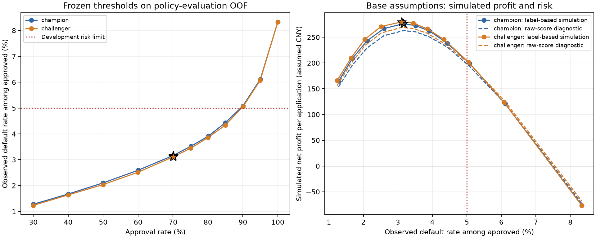
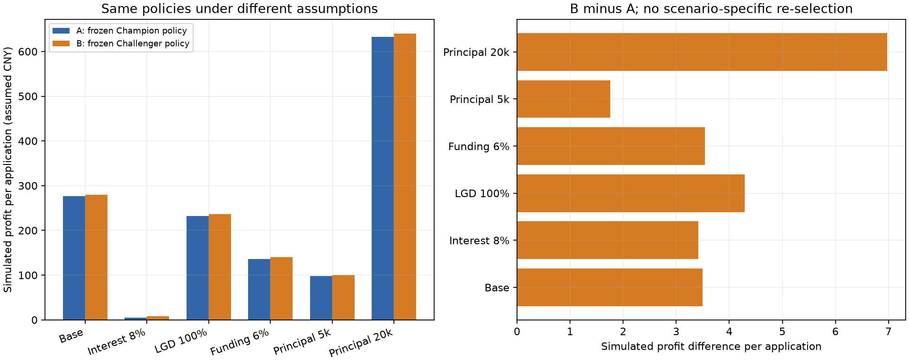
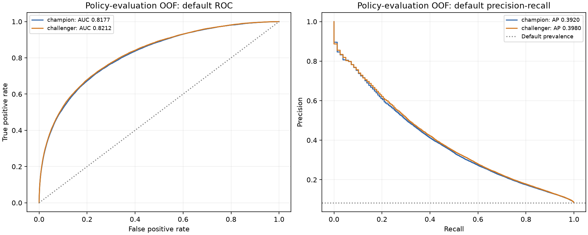
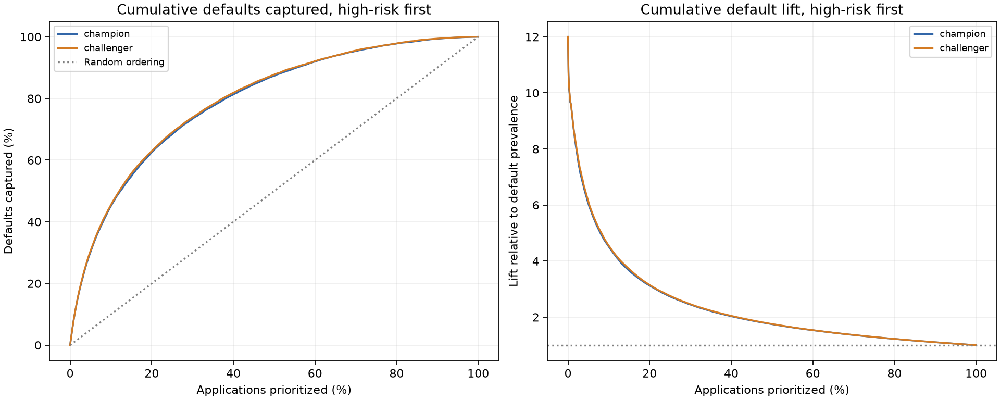

# 审批策略模拟：固定阈值、现金流与风险约束

## 本阶段结果

使用已冻结的 Champion（原始 LightGBM）和 Challenger（三种子集成），没有新增模型训练或概率校准。
将训练 OOF 按标签分层分成策略开发 **413,398** 行和策略评价 **275,600** 行。
只在开发子集拟合阈值、比较收益并选择 A/B 两套策略；评价子集和 36,324 条测试申请均使用冻结阈值。
此划分仅隔离本阶段的策略选择。底层 OOF 已用于模型开发，模型之间还有共享训练数据，
因此评价结果仍是历史开发数据的离线模拟，不能称为全新独立模型测试或真实 A/B 结果。

冻结后的 A、B 策略：

| prospective_arm | model_role | model_version | target_approval_rate | threshold | decision_rule |
| --- | --- | --- | --- | --- | --- |
| A | champion | lightgbm_baseline | 70.00% | 0.924794 | score_threshold |
| B | challenger | lightgbm_tuned_seed_ensemble | 70.00% | 0.925681 | score_threshold |

策略评价子集的基础情景结果：

| 策略 | 评价审批率 | 获批历史违约率 | 每申请模拟净收益（元） |
| --- | --- | --- | --- |
| A：Champion | 70.06% | 3.17% | 276.36 |
| B：Challenger | 70.04% | 3.11% | 279.86 |

在策略评价子集上，B 相对 A 的每个申请模拟净收益差为 **+3.50 元**。
这不是实际收入增长或显著性结论，当前没有随机分流、Bootstrap 实验区间或功效分析。
按同一 5% 风险上限和 50% 审批率下限检查，评价子集 A/B 通过状态为 **{'A': True, 'B': True}**，只是点估计检查。

## 1. 明确的模拟经济假设

| assumption | value |
| --- | --- |
| currency | CNY_assumed |
| horizon_months | 12 |
| principal | 10000.00 |
| interest_rate_for_horizon | 0.12 |
| loss_given_default | 0.80 |
| funding_rate_for_horizon | 0.04 |
| servicing_cost_per_approved | 100.00 |
| application_cost_per_application | 10.00 |

金额采用配置中的假设币种，期限统一为 12 个月；匿名 Kaggle 数据没有实际本金、币种、合同利率或还款日期。
每条申请都假设相同本金，采用简化的一期现金流，不模拟摊还、提前还款和不同违约时间。
`label=1` 时取得全部设定利息；`label=0` 时没有利息收入，损失本金的 LGD 比例。
资金成本和服务成本发生在所有获批贷款，申请成本发生在全部申请，包括拒绝申请。
**收回的本金不计入收益**，也没有把违约标签解释为损失 100% 本金。

```text
获批且还款：本金 × 利息收益率 − 本金 × 资金成本率 − 服务成本 − 申请成本
获批且违约：−本金 × LGD − 本金 × 资金成本率 − 服务成本 − 申请成本
拒绝申请：−申请成本
每个申请净收益：全体申请净收益合计 / 全体申请人数
```

基础假设下，获批还款/违约/拒绝一笔的净收益分别为
**690 / -8510 / -10 元**。
与拒绝相比的单笔审批增量盈亏平衡还款概率为 **0.9239**。
申请成本无论是否获批都产生，所以增量审批的盈亏平衡式不重复加入申请成本；这只是原始概率正确时的理论诊断。

## 2. 候选阈值、审批预算与选择规则

每个模型在策略开发分数上拟合 12 个目标审批预算。只按分数确定阈值，不用测试分数、评价标签或测试标签。
同分样本不按 ID 任意拆分；边界同分导致超预算时整组排除。因此真实审批人数可能低于目标。
审批规则为 `p_repay >= threshold`，另设全批/全拒两个端点。全拒策略的获批违约率为 NULL，人数为零，仍承担申请成本。

在基础情景、策略开发子集上，要求获批实际违约率 ≤ 5%、审批率 ≥ 50%，
分别选择每个模型下每个申请历史模拟净收益最高的策略。利润按六位小数比较，
平手时依次选择违约率更低、审批率更低、policy_id 更早的方案。没有可行方案时明确失败，不强行选择。
这是历史标签点估计下的开发规则，不是统计风险保证或生产审批。

相同目标审批预算在评价子集上的对照如下；冻结阈值下两组评价审批率可能不同：

| target_approval_rate | exactly_equal_approved_count | delta_approval_rate | delta_default_rate | delta_profit_per_application |
| --- | --- | --- | --- | --- |
| 0.00% | True | 0.00% | n.a. | 0.00 |
| 30.00% | False | -0.02% | -0.04% | 1.12 |
| 40.00% | False | -0.06% | -0.04% | 1.03 |
| 50.00% | False | -0.02% | -0.07% | 2.94 |
| 60.00% | False | -0.06% | -0.08% | 4.04 |
| 70.00% | False | -0.02% | -0.06% | 3.50 |
| 75.00% | False | -0.06% | -0.08% | 4.99 |
| 80.00% | False | -0.10% | -0.06% | 3.94 |
| 85.00% | False | -0.04% | -0.10% | 7.52 |
| 90.00% | False | 0.06% | -0.03% | 2.24 |
| 95.00% | False | -0.01% | -0.04% | 3.18 |
| 100.00% | True | 0.00% | 0.00% | 0.00 |

`exactly_equal_approved_count` 明确记录是否真正等量；差值均为 B 减 A，不把不同审批人群的坏账率差解释为因果改善。

## 3. 冻结策略的评价与测试应用

| prospective_arm | policy_cohort | threshold | approval_rate | observed_default_rate_approved | historical_profit_per_application | raw_score_implied_profit_per_application |
| --- | --- | --- | --- | --- | --- | --- |
| A | policy_development | 0.924794 | 70.00% | 3.21% | 273.59 | 262.85 |
| A | policy_evaluation | 0.924794 | 70.06% | 3.17% | 276.36 | 262.97 |
| A | unlabeled_test | 0.924794 | 17.01% | n.a. | n.a. | 37.30 |
| B | policy_development | 0.925681 | 70.00% | 3.12% | 278.84 | 269.27 |
| B | policy_evaluation | 0.925681 | 70.04% | 3.11% | 279.86 | 269.17 |
| B | unlabeled_test | 0.925681 | 17.05% | n.a. | n.a. | 38.92 |
| approve_all_control | policy_development | 0.000000 | 100.00% | 8.33% | -76.43 | -71.79 |
| approve_all_control | policy_evaluation | 0.000000 | 100.00% | 8.33% | -76.44 | -72.78 |
| approve_all_control | unlabeled_test | 0.000000 | 100.00% | n.a. | n.a. | -1536.68 |
| reject_all_control | policy_development | n.a. | 0.00% | n.a. | -10.00 | -10.00 |
| reject_all_control | policy_evaluation | n.a. | 0.00% | n.a. | -10.00 | -10.00 |
| reject_all_control | unlabeled_test | n.a. | 0.00% | n.a. | n.a. | -10.00 |

历史模拟收益使用 OOF 标签；`raw_score_implied_profit_per_application` 使用未经校准的原始模型分数，单独列示。
测试真实违约率和历史模拟净收益为 NULL（n.a.）。测试分数可以计算假设条件下的模型隐含收益，
但不能报告为真实收益或已验证的未来利润。训练—测试漂移，以及 OOF/测试平均模型数量的差异仍然存在。

**审批量漂移是本次模拟的重要限制**：A、B 测试审批率分别仅为 **17.01% / 17.05%**，
明显低于评价子集的 **70.06% / 70.04%**。
按开发选择采用的 50% 审批率下限检查，测试审批量通过状态为
**{'A': False, 'B': False}**。
这只是固定阈值下的审批量变化，不能推断测试真实坏账率。后续实验设计应先安排 shadow mode，
检查目标人群的分数分布、审批量和成熟标签风险，不能直接把 OOF 利润差作为上线收益预测。
此处保留原阈值，不利用测试分数事后调整配额。



## 4. 经济假设敏感性

分别改变利息、LGD、资金成本或本金；其他假设保持一致。全部情景使用同一套已经选好的 A/B 阈值，
不在不同情景重新挑策略，避免把事后最优方案混入固定策略对比。

| scenario_id | prospective_arm | historical_profit_per_application |
| --- | --- | --- |
| base | A | 276.36 |
| base | B | 279.86 |
| full_principal_loss | A | 232.00 |
| full_principal_loss | B | 236.29 |
| higher_funding | A | 136.24 |
| higher_funding | B | 139.78 |
| larger_principal | A | 632.77 |
| larger_principal | B | 639.75 |
| lower_interest | A | 4.99 |
| lower_interest | B | 8.41 |
| smaller_principal | A | 98.15 |
| smaller_principal | B | 99.91 |



## 5. 排序能力与风险捕获

ROC/PR 与 Lift/Gains 仅使用策略评价子集的 OOF；PR 以违约为少数正类，AP 为 Average Precision。
Gains 先按违约分数聚合同分，再从高风险向低风险累计。绘图抽稀不改变完整数据指标。





## 6. 核查与后续实验交接

核查状态 **passed**：SQL 聚合与逐申请 NumPy 现金流一致；本金收入、拒绝成本、零审批、
测试标签缺失、选择数据边界、同分预算、冻结阈值、配对差值、敏感性和逐申请 Parquet 均通过。
旧 SQL 分析库、冻结模型及历史训练记录以只读方式使用。

复现与字段说明：`docs/approval_policy_simulation.md`。
数据库：`data/interim/approval_policy_simulation.duckdb`；选定策略、开发/评价划分和逐申请收益在 `artifacts/approval_policy_simulation/`。
`experiment_policy_handoff.json` 给出后续实验设计使用的 A/B 规则和评价指标，尚未生成实验分组。

离线模拟额外假定：历史还款标签在不同审批决策与贷款条款下保持不变，数据覆盖拟讨论的申请人群。
真实审批可能改变人群、合同和客户行为；历史数据还可能存在已获批贷款的选择偏差。
没有借款日期和完整贷款生命周期，不能验证期限假设、逾期率、因果效应或生产风险。
下一步才能设计共同入组安全条件、随机化、样本量、结果成熟窗口和停止规则。
