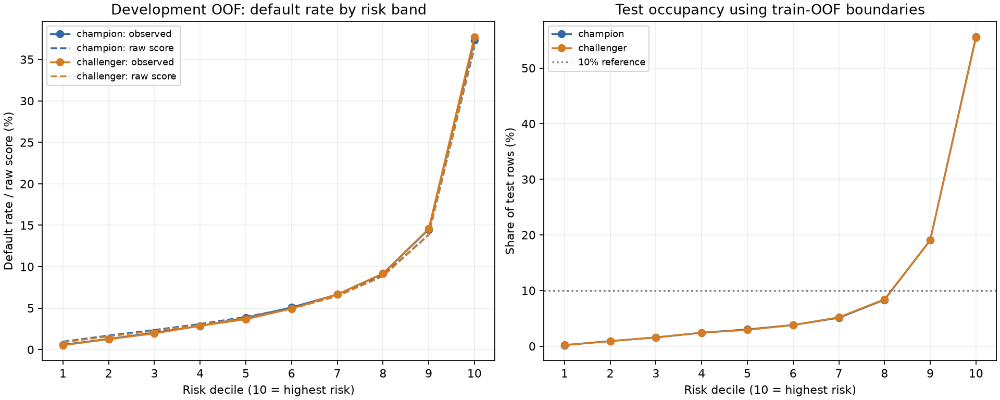
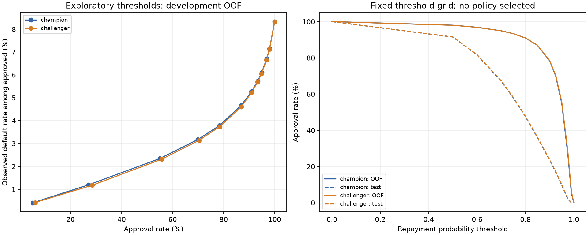

# SQL 业务分析：固定模型、风险分层与阈值描述

## 本阶段交付

冻结原始 LightGBM（Champion，5 个折模型）和调参三种子集成（Challenger，15 个折模型）。
688,998 条训练记录采用 OOF，36,324 条测试记录采用既有折模型平均；统一长表共 **1,450,644** 行。
没有新增模型训练、选择种子、重新推理、概率校准或选择最终审批策略。
Champion 是项目参照，不是已部署系统；两套模型均未上传 Kaggle，本报告没有官方测试成绩。

## 1. SQL 重算模型指标

| model_role | repay_roc_auc | default_pr_auc_ap | ks | log_loss | brier_score |
| --- | --- | --- | --- | --- | --- |
| challenger | 0.820395 | 0.395367 | 0.479461 | 0.224226 | 0.062114 |
| champion | 0.816569 | 0.388912 | 0.472156 | 0.225850 | 0.062500 |

Challenger 相对 Champion 的开发 OOF AUC 差为 **+0.003825**。
AUC、违约 AP、KS 均先聚合同分样本，再用 SQL 窗口累计计算；log loss 和 Brier 用 SQL 聚合。
违约 AP 定义为 Average Precision，以 `1-label` 和 `1-p_repay` 计算；log loss 概率截断为 1e-15。
独立 NumPy/sklearn 重算通过。KS 是模型分数对两类标签的区分度，与此前用于特征漂移的两样本 KS 不同。
现有折已被多轮开发重复使用，这些指标属于开发 OOF，不是独立最终验证或显著性结论。

## 2. 风险十分位与高风险识别

每个模型用训练 OOF 的违约分数 Q10–Q90 定义边界；D1 风险最低，D10 风险最高。
边界原样应用于测试集，测试分数不参与拟合边界。同分样本不拆开，空风险层仍输出。
分层是相对模型风险，没有虚构收入、年龄、地区等匿名特征含义。

| model_role | row_count | observed_default_rate | default_lift | default_capture_share |
| --- | --- | --- | --- | --- |
| challenger | 68900 | 37.73% | 4.528986 | 45.29% |
| champion | 68900 | 37.35% | 4.482818 | 44.83% |

`default_lift` = 层内实际违约率 / 全训练实际违约率；`default_capture_share` = 层内违约人数 / 全训练违约人数。
完整十分位表还记录还款率、还款提升度、平均原始违约分数，以及从高风险到低风险累计捕获的违约比例。
原始模型概率未校准，分数均值与实际违约率分别展示。

## 3. 训练与测试分数分布

| dataset | model_role | mean_p_repay | p10 | p50 | p90 | observed_default_rate |
| --- | --- | --- | --- | --- | --- | --- |
| test | challenger | 0.758775 | 0.518940 | 0.789765 | 0.950290 | n.a. |
| train | challenger | 0.917715 | 0.814429 | 0.956749 | 0.987308 | 8.33% |
| test | champion | 0.757970 | 0.518003 | 0.788497 | 0.949453 | n.a. |
| train | champion | 0.917154 | 0.814312 | 0.955694 | 0.986397 | 8.33% |

| model_role | score_psi | decile_total_variation |
| --- | --- | --- |
| challenger | 1.876002 | 0.545374 |
| champion | 1.897384 | 0.546723 |

测试没有标签，实际违约率、实际还款率、违约人数和捕获率均为 NULL（表中 n.a.），不是零。
分数 PSI 使用同一套训练 OOF 十分位，零占比用 1e-6 下限处理。
分数差异既可能包含数据漂移，也可能包含平均模型数量的差异：Champion OOF 每行用 1 个模型、测试用 5 个；
Challenger OOF 每行用 3 个模型、测试用 15 个。因此 PSI 只用于诊断，不能推断测试标签分布或真实风险。

## 4. 固定阈值网格的描述性分析

配置提前固定 13 个还款概率阈值，审批规则是 `p_repay >= threshold`，等于阈值时获批。
下表的 0.8、0.9、0.95 仅用于展示，其余阈值见完整 CSV；本阶段没有按结果挑选阈值。

| model_role | threshold | approval_rate | observed_default_rate_approved | mean_model_p_default_approved |
| --- | --- | --- | --- | --- |
| challenger | 0.800000 | 90.94% | 5.23% | 5.21% |
| champion | 0.800000 | 90.95% | 5.27% | 5.30% |
| challenger | 0.900000 | 78.50% | 3.74% | 3.85% |
| champion | 0.900000 | 78.35% | 3.79% | 3.93% |
| challenger | 0.950000 | 55.74% | 2.32% | 2.55% |
| champion | 0.950000 | 54.95% | 2.35% | 2.62% |

审批率分母是全部申请；获批实际违约率分母是具有标签的获批申请。无人获批时实际违约率为 NULL。
测试只能输出审批占比和获批平均模型分数。`champion_challenger_comparison` 比较相同概率阈值，
两组审批率可能不同，不能把获批违约率差直接解释成同一人群的因果改善。

## 5. 数据来源和核查

新数据库：`data/interim/sql_business_analysis.duckdb`。旧数据质量数据库以只读方式读取，复用其物理质量表与漂移表。
冻结清单：`artifacts/sql_business_analysis/model_freeze_manifest.json`，使用项目相对路径和 SHA256，保留历史记录的原路径。
已检查 20 个完整折模型的文件校验值，以及折预测重建、OOF 覆盖、三种子平均、ID/标签/折号一致性。
本阶段没有重新运行原始特征的模型推理；历史原生模型重载核查记录保留，当前核查范围为：
**current model hashes, checkpoint reconstruction and ID/label/fold alignment; historical native reload audit retained**。

独立核查状态：**passed**。冻结输入和输出校验值、SQL 指标、分层、阈值分母、缺失标签、
测试共用边界、分数 PSI、配对差值和 11 份 CSV 全部通过。
复现命令与字段字典见 `docs/sql_business_analysis.md` 和 `docs/sql_business_data_dictionary.md`。

## 6. 完成边界

本阶段完成模型冻结和 SQL 业务分析。审批收益假设、风险约束下的最终策略选择、
A/B 分流、功效分析、实验周期及离线实验模拟留待后续。
后续实验需明确历史标签在不同审批策略下保持不变等离线假设，不能把本报告写成真实随机实验成果。
